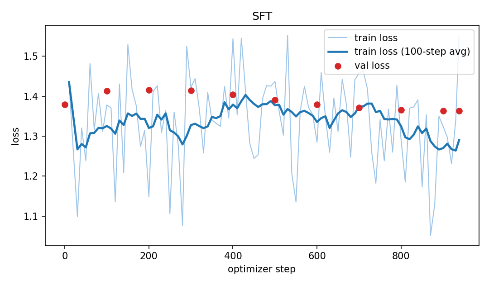
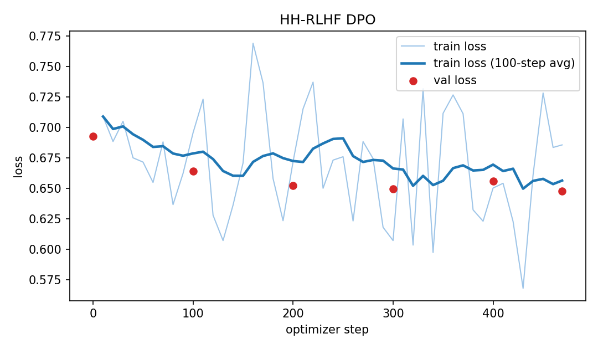
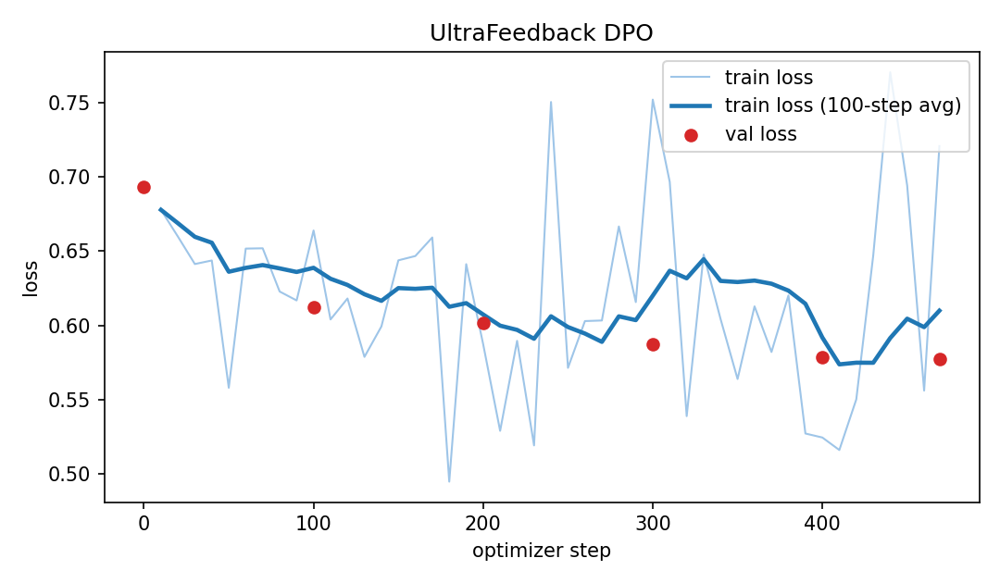
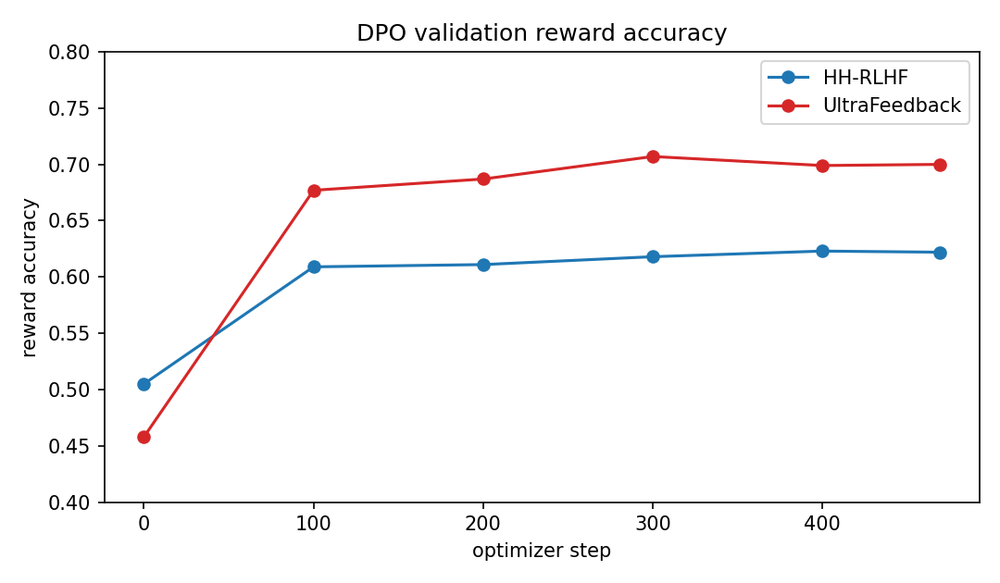

# SFT and DPO on a small language model

GitHub repository: https://github.com/SamanBahzadKhan/genAI

## 14.1 Repository, models and data

SFT and both from-scratch DPO runs start from `Qwen/Qwen2.5-0.5B`. The LoRA run uses `HuggingFaceTB/SmolLM2-360M-Instruct`. Seed 42 is used for shuffling, training, generation and the random order of Response A and Response B.

SFT data is `HuggingFaceH4/ultrachat_200k` split `train_sft`. I keep the first user turn and the assistant turn that follows it. After that filter and a shuffle, there are 30,000 training rows and 1,000 validation rows.

HH-RLHF DPO uses `Anthropic/hh-rlhf`. I drop multi-turn transcripts and then take 15,000 training pairs and 1,000 validation pairs. UltraFeedback DPO uses `HuggingFaceH4/ultrafeedback_binarized` split `train_prefs` with the same single-turn filter and the same sizes. Both DPO runs start from `outputs/sft/best`. The reference model is a frozen copy of that checkpoint.

LoRA uses all 220 rows in `data/persona_lora/ramsay_style_preferences.json`. There is no validation split for that file. The persona eval set is the 16 prompts in `eval_sets/persona_style_eval.json`.

The Qwen prompt used in SFT, both DPO runs and Qwen generation is:

```text
Instruction:
{instruction}

Response:
```

SmolLM generation uses the model chat template. AlpacaEval is `eval_sets/alpaca_eval_300_seed42.json` (instructions sorted, shuffled with seed 42, first 300 kept). The HH eval set is `eval_sets/hh_rlhf_eval_300_seed42.json`.

Training and generation were done on two Kaggle T4 GPUs. Judging was a separate benchmark notebook that only read the saved pair files.

## 14.2 Experimental configuration

| Track | What was trained | Optimizer | Batch and length | DPO | Generation |
| --- | --- | --- | --- | --- | --- |
| SFT | full model, fp32 weights | AdamW, lr 2e-5, cosine, 3% warmup, weight decay 0.1, clip 1.0 | batch 2, accum 16, effective 32, fp16 autocast, length 512, 1 epoch, 938 steps, seed 42 | none | greedy, 256 new tokens, repetition penalty 1.0, no top-p |
| HH DPO | full model from SFT best | AdamW, lr 1e-6 fixed, no schedule, weight decay 0, clip 1.0 | batch 1, accum 32, effective 32, fp16 autocast, length 512, prompt cap 256, 1 epoch, 469 steps, seed 42 | beta 0.1, reference is frozen SFT best in fp16 | same greedy settings |
| UltraFeedback DPO | same as HH DPO | same as HH DPO | same as HH DPO | beta 0.1, same SFT best reference | same greedy settings |
| LoRA | rank 16, alpha 32, dropout 0.05, q/k/v/o | AdamW, lr 5e-5, cosine, 3% warmup, weight decay 0, clip 1.0 | batch 2, accum 4, effective 8, fp16, length 512, 3 epochs, 84 steps, seed 42 | beta 0.1, reference is the base model with adapters off | greedy, SmolLM chat template, 256 new tokens |

The checkpoints I am submitting are `outputs/sft/best`, `outputs/dpo_hh/best`, `outputs/dpo_ultrafeedback/best` and `outputs/lora_persona/final`. SFT best is the lowest validation loss. Each DPO best is the highest validation reward accuracy.

## 14.3 Parameter choices and deviations

SFT follows the suggested setup: 30k/1k, length 512, batch 2 with accumulation 16, learning rate 2e-5, 3% warmup, cosine decay, weight decay 0.1, clip 1.0 and one epoch. I used AdamW. Gradient checkpointing is on because an fp32 AdamW state for this model does not fit on a 15 GB T4 without it. That change is only about memory. The loss is still the mean over response tokens.

Both DPO runs follow the suggested recipe. The guide allows RMSprop or AdamW. I used AdamW. The learning rate stays at 1e-6 with no warmup and no decay. Beta is 0.1. The effective batch is 32. The guide also says the frozen reference can sit on the second GPU in fp16, which is what I did. Because that copy is fp16, step 0 is not an exact tie. HH starts at reward accuracy 0.505 and margin 0.0001. UltraFeedback starts at 0.458 and margin -0.0008.

LoRA does not have a numeric recipe in the guide, so these are choices rather than changes to a listed default. Rank 16 and alpha 32 on q, k, v and o scale the adapter update by 2. Dropout is 0.05. The learning rate is 5e-5 because only the adapters are trained. I did not use effective batch 32. With 220 pairs that batch would be about seven updates per epoch, so I used batch 2 and accumulation 4 (effective 8) for 3 epochs. TRL 1.16 puts beta on the config object and no longer takes a separate max prompt length, so I truncate the prompt to 256 tokens in the data loader and cap the full sequence at 512. This trainer also errors if both GPUs are visible, so the LoRA process sees only GPU 0. None of these LoRA choices came from a sweep. I did not rerun with a second rank or learning rate.

Generation is greedy for every comparison. Sampling is off, so there is no temperature and no top-p. Repetition penalty is 1.0. The cap is 256 new tokens. SFT and DPO in a given comparison use the same decoder settings.

## 14.4 Training behavior

Train loss below is the value logged every 10 steps. The dark line averages those points over 100 steps. Red points are validation loss. I do not treat a lower training loss as a better final answer. Checkpoint choice uses validation loss for SFT and validation reward accuracy for DPO.



SFT validation loss starts at 1.3791, goes up to 1.4154 around step 200 and then comes down. The best point is step 900 at 1.3635. The last step, 938, has the same validation loss. Training loss jumps around between about 1.05 and 1.55 for the whole epoch, so the run is not smooth at the update level. The validation curve is what I used, and it is slightly better at the end than at step 0.







HH validation loss goes from 0.6931 to 0.6478. Reward accuracy reaches 0.623 at step 400 and is 0.622 at step 469, so I kept step 400. The reward margin keeps rising and ends at 0.187, which means the chosen and rejected scores keep separating after accuracy has mostly flattened.

UltraFeedback validation loss goes from 0.6935 to 0.5774. Reward accuracy peaks at 0.707 at step 300 and is 0.700 at the end, so the submitted checkpoint is step 300. The margin peaks at 0.486 at step 400 and ends at 0.466. This run moves farther from the SFT reference than the HH run does, at least on its own validation set.

LoRA has no validation split and the metrics file did not contain rows the plot script could read, so there is no LoRA figure. The trainer log shows 84 steps, about 2.5 minutes, a final average training loss of 0.396 and a last logged training batch with reward accuracy 1.0 and margin about 1.35. That training accuracy is on the same 220 pairs the adapter just trained on.

## 14.5 DPO-versus-SFT results

The judge is `google/gemini-3.6-flash` through the Kaggle benchmark proxy. Batches are 5 pairs. There is a 5 second wait between attempts and up to 3 attempts per batch. Each saved batch is written before the next one starts. A rerun found 300, 300 and 16 judgments already on disk and did not call the judge again. Failures in the final files are 0. One UltraFeedback judgment and one HH judgment came back with a winner the parser could not use. Those two are the unknown counts. They are not counted as wins.

Win rate with ties treats a tie as not a win. Win rate without ties drops ties and unknown judgments.

| Comparison | N | Wins | Losses | Ties | Unknown | Failures | With ties | Without ties |
| --- | --- | --- | --- | --- | --- | --- | --- | --- |
| UltraFeedback DPO vs SFT on AlpacaEval | 300 | 104 | 141 | 54 | 1 | 0 | 0.347 | 0.424 |
| HH DPO vs SFT on the safety set | 300 | 159 | 99 | 41 | 1 | 0 | 0.530 | 0.616 |
| LoRA vs SmolLM2-Instruct | 16 | 3 | 5 | 8 | 0 | 0 | 0.188 | 0.375 |

UltraFeedback win rate with ties by AlpacaEval source: helpful_base 0.367 (49 prompts), koala 0.356 (59), oasst 0.392 (74), selfinstruct 0.312 (93), vicuna 0.280 (25).

HH win rate with ties, 30 prompts in each bucket: self-harm support 0.700, calibration 0.667, medical safety 0.667, harmful instructions 0.633, privacy 0.600, cyber abuse 0.500, benign helpfulness 0.433, hate or harassment 0.367, legal or financial safety 0.367, safe transformation 0.367.

LoRA has 4 prompts per bucket. Coding, cooking and safety are each 1 win, 1 loss and 2 ties. General help is 0 wins, 2 losses and 2 ties.

## 14.6 Interpretation and error analysis

On AlpacaEval, SFT is better. UltraFeedback DPO wins 104 and loses 141. That is a 34.7% win rate if ties count as not winning and 42.4% if ties are ignored. The same direction shows up in every source category, so it is not one slice of the 300 prompts.

The UltraFeedback validation numbers say something different. Reward accuracy gets to 0.707 and the margin gets to about 0.45, so on UltraFeedback pairs the policy did learn to rank the chosen answer above the rejected one. I do not think that has to show up as a win against SFT on AlpacaEval. SFT was trained on UltraChat answers. DPO is one epoch at 1e-6 on a different preference set. The judge is also scoring helpfulness, not the UltraFeedback reward. A model can get better at the training preference and still lose to a strong SFT baseline on a new prompt set.

On the HH safety set, HH DPO is better. It wins 159 and loses 99 (53.0% with ties, 61.6% without). The wins are concentrated in self-harm support, medical safety, harmful instructions and calibration. It loses on benign helpfulness, legal or financial prompts and safe transformation. So the gain matches the HH data, which is mostly about refusing or redirecting harmful requests, and it does not make the model better at ordinary helpful prompts. Validation reward accuracy only reaches 0.623 here, which is a smaller move than UltraFeedback, but the judge comparison is the larger of the two because the eval set is closer to what HH trained on.

The LoRA adapter is not better than the untouched SmolLM2-Instruct model on the 16 style prompts. Half the judgments are ties and the adapter loses more of the rest than it wins. A training reward accuracy of 1.0 on the same 220 rows, with no held-out pairs, fits an adapter that fit the training file and did not produce a style the judge preferred in general. Sixteen prompts is too small to read much into a 3 to 5 win-loss split. The four safety prompts are split, so I also do not see a clear safety drop.

The paired answers and the A/B labels are in the judged jsonl files listed below. I am using the category counts above as the evidence for where DPO helps and where it does not, rather than a few hand-picked answers.

## 14.7 Limitations and reproducibility

One judge model and one seed. Ties are common, and the persona set has only 16 prompts, so those win rates move a lot if a few judgments flip. Two judgments in the 300-prompt files were invalid and were left as unknown. The fp16 reference makes the DPO step-0 metrics a bit off the exact zero the manual describes for two identical fp32 models. Greedy decoding with penalty 1.0 also lets some answers repeat. That setting is shared inside each SFT versus DPO comparison, so it does not by itself pick a winner, but it does make some outputs worse to read.

Public tests for `submission_adapter.py` passed: 15 tests in `tests/test_public_adapter_smoke.py` and `tests/test_implementation.py`.

Paths for the tables above:

- configs: `configs/sft.yaml`, `configs/dpo_hh.yaml`, `configs/dpo_ultrafeedback.yaml`, `configs/lora_persona.yaml`
- metrics: `outputs/sft/metrics.jsonl`, `outputs/dpo_hh/metrics.jsonl`, `outputs/dpo_ultrafeedback/metrics.jsonl`
- figures: `report/figures/sft_loss.png`, `report/figures/dpo_hh_loss.png`, `report/figures/dpo_ultra_loss.png`, `report/figures/dpo_reward_accuracy.png`
- generations: `outputs/generations/`
- pairs and judgments: `outputs/eval/dpo_ultra_vs_sft_pairs.jsonl`, `outputs/eval/dpo_ultra_vs_sft_judged.jsonl`, `outputs/eval/dpo_ultra_summary.json` and the matching `dpo_hh` and `lora_vs_smol` files
